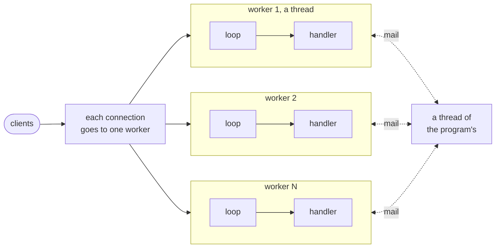

# goose-http

An HTTP/1.1 server package for [Goose](https://github.com/aardappel/goose), with one
event loop per worker, inspired by [Tina](https://github.com/pmbanugo/tina). It uses
io_uring or epoll on Linux, kqueue on macOS, and I/O completion ports (IOCP) on Windows.

Experimental: tested and benchmarked, but not yet used in production. The API still
changes between tags.

[Examples](examples/README.md) · [Patterns](docs/patterns.md) · [API](docs/api.md) ·
[Benchmarks](docs/benchmarks.md) · [Architecture](docs/architecture.md) · [Embedded Linux](docs/embedded.md) ·
[Development](docs/development.md) · [Changelog](CHANGELOG.md)

For a full framework with typed routes, extractors, middleware, and optional route
generation from OpenAPI, see [goose-rest](https://github.com/kaitk/goose-rest).

## Status

🟢 works · 🟡 planned or partial · ⚪ later · 🔴 out of scope

| | Protocol | Notes |
|---|---|---|
| 🟢 | HTTP/1.1 | Keep-alive, pipelining, chunked bodies, trailers, and `Expect: 100-continue`. Also supports HTTP/1.0. |
| 🟢 | Compression | Files compressed with Brotli, Zstandard, or gzip; on-the-fly gzip, deflate, and Zstandard with [goose-compress](https://github.com/kaitk/goose-compress). |
| 🟡 | HTTP/2 | h2c, HTTP/2 over TCP with prior knowledge, on a port of its own, on Linux and macOS ([API](docs/api.md#several-ports-and-h2c)). Not yet over TLS. |
| 🟡 | TLS | HTTPS: HTTP/1.1 over TLS 1.3 on the epoll and kqueue loop, on a port of its own, from the module `http.tls` with [goose-tls](https://github.com/kaitk/goose-tls) and OpenSSL 3 ([API](docs/api.md#https)). Not yet in io_uring's loop, nor with h2 or the kernel's TLS on Linux. |
| 🟢 | WebSocket | RFC 6455: text and binary messages, fragments, ping, and close, in the optional `http.websocket` module, with SHA-1 from [goose-hash](https://github.com/kaitk/goose-hash) ([API](docs/api.md#websocket)). Passes Autobahn's test suite. No extensions, such as permessage-deflate, and not over HTTP/2. |
| 🟡 | Outbound connections | TCP and Unix sockets to other servers, such as a database: blocking calls with time limits for a lane's thread, and non-blocking ones on the epoll and kqueue loop, where the exchange waits for the socket ([API](docs/api.md#outbound-connections)). Not yet in io_uring's or IOCP's loop; host names other than `localhost` aren't resolved yet. |
| ⚪ | HTTP/3 | Deferred until QUIC on Linux matures; it currently uses more CPU than TCP for the same traffic. |

| | Platform | Notes |
|---|---|---|
| 🟢 | Linux | io_uring (kernel 6.1+) or epoll ([which loop](docs/api.md#event-loops)). |
| 🟢 | macOS | kqueue. |
| 🟢 | Windows | I/O completion ports (IOCP). |
| 🟡 | Embedded Linux | aarch64 cross-builds pass tests under emulation, but have not yet been tested on a board ([embedded Linux](docs/embedded.md)). |

## What it provides

The latest tag, `v0.4.0`, provides all of this on every platform above:

- A strict parser that guards against request smuggling and returns 414, 431, 501, and
  505 where appropriate; header fields, path, query, and percent-decoding support.
  Response fields reject CR, LF, and invalid names.
- A router with parameters, wildcards, `OPTIONS`, and 405 with `Allow`.
- Streaming request bodies and responses of any size; form and multipart bodies; JSON
  responses.
- Static files with conditional `GET` and a single byte range; files over 64 KB are sent
  without copying.
- Cookies, `Basic` authorization, media types, and `Accept` (406, 415).
- Limits and timeouts per connection and per route, graceful shutdown, and an access log.
- Deferred responses: waiting for another thread or a timer, long polling, and SSE.
- Client addresses, `Forwarded` headers from trusted proxies, IPv6, dual-stack, and, on
  Linux and macOS, Unix sockets.

The package does not include an HTTP client or framework features such as CORS,
sessions, and middleware (see [goose-rest](https://github.com/kaitk/goose-rest)).

## Quick start

Build Goose at commit
[`f114b5a`](https://github.com/aardappel/goose/commit/f114b5ac52cfad4bc73038aede53ac7e470b0ad3)
and put its directory on `PATH`
([Goose's build notes](https://github.com/aardappel/goose#build-and-run)): `http::run`
needs [aardappel/goose#37](https://github.com/aardappel/goose/pull/37), which no Goose
release has yet. Building a program also needs a C compiler and, on Linux, liburing:

- **Linux:** gcc or clang, with `libc6-dev` and `liburing-dev` (Debian, Ubuntu).
- **macOS:** the Xcode command line tools (`xcode-select --install`).
- **Windows:** the Visual Studio 2022 or later Build Tools, with the C++ workload.

Save this as `hello.goose`:

```rust
import http from "github.com/kaitk/goose-http@v0.4.0";

thread_fn worker(cfg: http::Config) {
    let e = http::serve(cfg) { req, body, out =>
        if http::path_of(req.target) == "/" {
            http::respond(out, 200, "text/plain", "Hello, World!");
        } else {
            http::respond(out, 404, "text/plain", "");
        }
    };
    http::report(e);
}

fn main() {
    http::run(http::Config { port: 8080, .. }, worker);
}
```

Build it and run it, then open <http://localhost:8080/>:

```sh
goose build hello.goose
./hello
```

*Note: `goose hello.goose` runs the program inside the compiler through TinyCC, which
can't start threads. A server with workers needs `goose build`.*

The [examples](examples/README.md) cover routes, JSON, uploads, files, and deferred
responses.

## Concepts



- **Workers.** The program starts one thread per worker. Each worker runs an event loop
  with the same handler and owns its connections. Workers share no memory; threads
  communicate by [mail](docs/patterns.md#mail-between-threads). A handler must never
  block its loop, so slow work runs on a lane, threads of its own that
  `http::lane_open` starts, while the handler waits for the reply: the
  half-sync/half-async pattern ([slow work](docs/patterns.md#slow-work)).
- **Two kinds of handler.** `{ req, body, out => }` receives a complete request and
  responds once, which is enough for most routes. `{ ev, st, out => }` runs for each
  event in an exchange and keeps program-defined state per connection. Use it for large
  bodies, long responses, files, and deferred responses
  ([which to use](docs/patterns.md)).
- **The request is borrowed.** Its head, fields, and route parameters point into the
  read buffer and remain valid until the handler returns. Reading a request allocates
  nothing.
- **For early returns, use a handler function**, passed by name or called from the
  block. A `return` in the block exits the worker's loop
  ([why](docs/api.md#handler)).
- **`http::Config`** holds the address, limits, timeouts, and buffer sizes, all with
  defaults. `http::stop_on_signals()` stops the loops gracefully on Ctrl+C or `SIGTERM`.
- **Errors are values.** A loop returns an `http::Error` identifying the failed call
  and its error code. `http::exit_on_error` prints the error and ends the process.
- **An abort ends the process**, as an index out of bounds does in any thread. Run the
  server under systemd, Docker, or Kubernetes, which restarts it
  ([crashes](docs/patterns.md#a-crash-ends-the-process)).

For the API organized by topic, with examples, see [docs/api.md](docs/api.md).

## Benchmarks

goose-http `v0.3.7` and Goose `v2026.2` on a Ryzen 7 5800X3D (WSL2), 4 workers per
server. [All results, the method, and the losses](docs/benchmarks.md).

The plaintext and JSON benchmarks serve tiny fixed responses over 256 connections,
with pipelining for plaintext. They mainly measure the event loop and parser. The REST
APIs [below](#rest-apis) are closer to a real application.

| Workload | goose-http | Best other | |
|---|---:|---:|---|
| [Plaintext](docs/benchmarks.md#plaintext-and-json) | 7.10M req/s | 8.12M (vanilla-io_uring\*) | Fastest that parses requests |
| [JSON](docs/benchmarks.md#plaintext-and-json) | 517k req/s | 561k (zix) | Third of 8 |
| [Peak RSS](docs/benchmarks.md#plaintext-and-json), plaintext and JSON | 4.9-16 MB | 39 MB (zix) | Lowest |
| 1 MB [static files](docs/benchmarks.md#static-files)\*\* | 31.3 GB/s | 28.5 GB/s (nginx) | Behind only at 64 KB |
| [Compressed JSON](docs/benchmarks.md#compression)\*\* | 66.1k req/s | 62.6k (actix) | Fastest that compresses each response |

\* Responds without parsing the request; so does libreactorng, at 7.02M req/s.  
\*\* Measured on a build earlier than `v0.3.1`.

### REST APIs

Three APIs and an upload workload. All servers use the same routes and records, load
the records at startup, and compute each response per request, without a framework.
goose-http's rates are measured at `v0.3.7` with Goose `v2026.2`, dusty's right after
them on the same machine, xitca-web's in an earlier session, and goose-http's reads p99
on an earlier build.

- **A** is [HttpArena](https://github.com/MDA2AV/HttpArena)'s `production-stack` API.
- **B** and **C** come from a time tracker and a clinic, with larger, more deeply nested JSON.
- **Templates** builds each record's JSON once at startup.
- **Reads p99** measures C's p99 latency at a fixed request rate while uploads run.

| Workload | goose-http | xitca-web (Rust) | dusty (Zig)\* |
|---|---:|---:|---:|
| [A](docs/benchmarks.md#tier-a): HttpArena's items, 0.2 KB | **608k req/s** | 407k | 359k |
| [B](docs/benchmarks.md#tier-b): sessions and time entries, 0.3-13 KB | **316k req/s** | 235k | 177k |
| [C](docs/benchmarks.md#tier-c): schedules and records, up to 728 KB | **64.0k req/s** | 38.2k | 25.7k |
| C, templates | **153k req/s** | 113k | 136k |
| [Uploads](docs/benchmarks.md#uploads): CSVs and multipart files, up to 8 MB | **1,192 req/s** | 1,016 | 1,151 |
| Reads p99 beside uploads | **1.8-2.6 ms** | 2.4-4.6 ms | 6.7-42 ms |

\* A framework; its counterpart is [goose-rest](https://github.com/kaitk/goose-rest).

Goose uses io_uring, except for uploads and reads p99, which use epoll. Results for
every server and both Goose event loops: [docs/benchmarks.md](docs/benchmarks.md#rest-apis).

## What isn't Goose

All HTTP functionality is written in Goose: parsing, routing, responses, event loops,
mail between threads, timers, and JSON. The package's only other code is a thin C layer in
`shim/` for four things Goose can't do:

- Call the kernel and convert its data structures: sockets, epoll, kqueue, and Winsock.
- Own buffers the kernel uses after a call returns: the io_uring and IOCP rings.
- Provide an interruptible wait with atomic counts: a box's queue.
- Hold memory that all threads can read: the blobs in the store, `http.store`.

The optional `http.websocket` module adds goose-hash's C, which runs the handshake's
SHA-1 on the CPU's SHA instructions where it has them. For each file and why it uses C,
see the [architecture](docs/architecture.md#what-isnt-goose).

## Credits

The boxes draw three ideas from [Tina](https://github.com/pmbanugo/tina), a
thread-per-core framework in Odin, and its author's post
[on async/await](https://pmbanugo.me/blog/why-async-await-complect-concurrency):

- A box's capacity is fixed at creation. A send reports a full box or stale address
  immediately, without blocking or growing the box.
- The sender directs work to a worker's address rather than a shared queue.
- Every wait requires a time limit (`http::later`).

One more comes from Tina: a lane's stop can't be crowded out by traffic, as Tina
reserves messages for shutdown (here a flag in the box, `http::mail_stop`).
