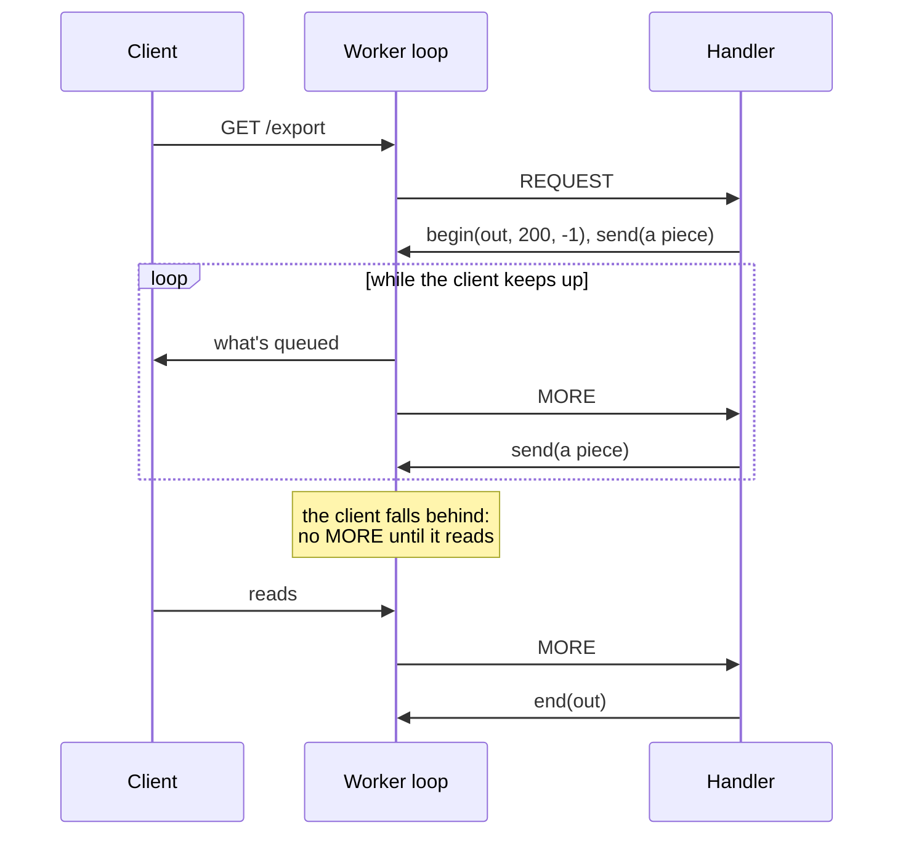
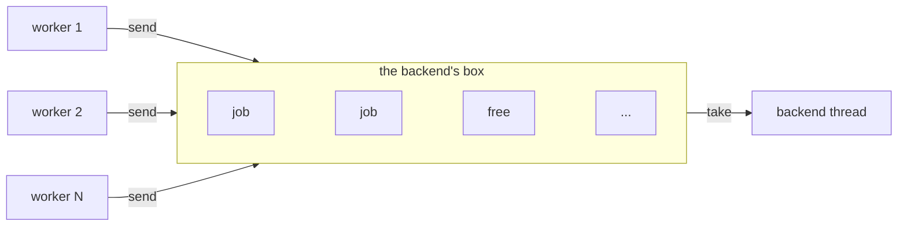
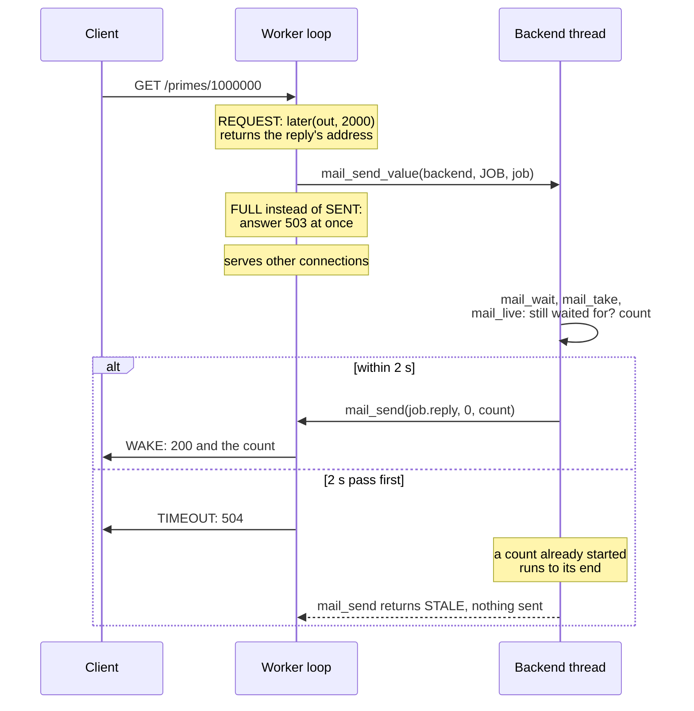

# Server patterns

How to shape a server for large request bodies, long responses, slow work, and state
that workers share. Each section gives the pattern first, then the example that shows
it and the [API](api.md) that has the details. It builds on the README's
[concepts](../README.md#concepts).

One fact explains each of these patterns: a worker is a single thread that runs the
handler for every connection it owns, thousands of them, one call at a time. Any time a
handler spends waiting holds up each of those connections, and memory a handler keeps
is multiplied by the connections doing the same.

## Request bodies

Pick by how large a route's bodies get:

- **Up to 8 KB, with the head**: `body` already holds it, in the plain handler
  `{ req, body, out => }`. Most JSON requests fit. The limit is `Config.max_head`, the
  read buffer's size.
- **Larger, and needed whole**, as a large JSON document: wrap the handler in
  `http::gather` with a limit. It calls your code once, with the whole body. The worker
  holds each body it gathers in memory until your code returns, so set the limit to
  what it can hold for every connection gathering at once. Shown in
  [`upload/`'s `/words`](../examples/upload/upload.goose).

  ```goose
  struct Doc { body: http::Gather = http::Gather { .. } }

  let e = http::serve(cfg, Doc { .. }) { ev, st, out =>
      http::gather(ev, st.body, out, 4 << 20) { req, body, o =>
          // body is the whole request body, up to 4 MB.
          http::respond(o, 200, "text/plain", "ok");
      };
  };
  ```

- **Any size, read as it arrives**, as a file upload or a CSV import: use a handler
  with state, `{ ev, st, out => }`. It's called with each piece of the body as it
  arrives, so memory stays the same however large the body is. A body that fits the
  read buffer comes whole at `REQUEST`; a longer one starts there, goes on in `BODY`
  pieces, and ends at `END`. Shown in
  [`upload/`'s `/upload` and `/form`](../examples/upload/upload.goose).

  ```goose
  struct Upload { bytes: i64 = 0 }

  let e = http::serve(cfg, Upload { .. }) { ev, st, out =>
      if ev.kind == http::REQUEST || ev.kind == http::BODY {
          st.bytes += ev.data.len;   // a piece: write it to a file, or parse its lines
      }
      if (ev.kind == http::REQUEST && ev.whole) || ev.kind == http::END {
          var text: u8[..24] = [];
          format(text, st.bytes, " bytes\n");
          http::respond(out, 200, "text/plain", text);
      }
  };
  ```

A body over 1 MB gets 413 on every route until you raise `Config.max_body`, the
server's limit, as the first snippet needs for its 4 MB. `http::gather`'s limit and `http::body_within` set lower ones per route.

In the plain handler, a body over 8 KB isn't an error: `body` is empty, and the rest of
it is dropped. A route that can get one needs one of the other two.

## Long responses

A response the handler builds whole can be any size: the worker holds it until it's
sent. A response too large to hold, or made over time, goes in pieces instead:

- **Files**: `http::serve_file`, then `http::send_file` until it's done. Files of 64 KB
  or more go from the disk to the socket without passing through the program. Shown in
  `files/`.
- **Generated data**, such as an export: `http::begin` the response, and `http::send`
  a piece each time the loop calls with `MORE`. Shown in `compress/`.
- **Events over time**, such as Server-Sent Events: send a piece, then wait for the
  next with `http::later`, as in [slow work](#slow-work). Shown in `device/`.

The loop calls with `MORE` only while the client takes what it's sent, so a slow client
can't make the worker hold a whole response:



## Mail between threads

Threads share no memory, so they send each other messages. A thread that takes messages
owns a box: a fixed number of slots, each of a fixed size, set when the box opens. Any
thread sends to a box's address, and the send never blocks or grows the box. Here every
worker sends jobs to a backend thread's box, two of whose slots are taken:



A send says at once whether the message went in, `SENT`, or why not:

- `FULL`: every slot is taken. The sender decides what the client gets, such as 503.
- `TOO_LONG`: the message is longer than a slot. Send it in pieces, or open the box
  with larger slots.
- `STALE`: nobody waits at that address any more, so the work can be dropped.

A worker waits for mail with `http::later`, which takes a time limit and returns the
address to reply to. How to shape the backend thread, and the work it takes:
[slow work](#slow-work). With goose-rest, a route asks a service thread with
`rest::ask`, and the service answers it:
[goose-rest's waiting](https://github.com/kaitk/goose-rest/blob/main/docs/architecture/README.md#waiting-on-another-thread).

The design is [Tina](https://github.com/pmbanugo/tina)'s, a thread-per-core framework in
Odin: boxes bounded when they open, work sent to a thread's address rather than to a
shared queue, and a time limit on every wait. Its author explains the reasons in
[a post on async/await](https://pmbanugo.me/blog/why-async-await-complect-concurrency).
How the boxes work: [architecture](architecture/README.md#waiting-answers-logging-and-shutdown).

## Slow work

A handler should answer in microseconds. Work that takes longer runs on a thread of the
program's own, and the handler waits for it without blocking the worker:

| The work takes | Where it runs | Shown in |
|---|---|---|
| Microseconds: parse, look up, format | In the handler | `routes/`, `api/` |
| Milliseconds to seconds | A thread of the program's; the handler waits with `http::later` | `later/` |
| As long as it goes on, with results as they come | The same, with the response sent in pieces | `device/`, `server/`'s `/events` |
| Minutes | A job: answer `202 Accepted` with its ID at once, and let the client ask for the result | No example yet |

The handler sends the job by mail and gives a time limit. The worker serves its other
connections until the reply or the time limit comes:



- **A job can't be stopped from outside.** Once it starts, it runs to its end, past its
  time limit if need be. Check `http::mail_live(reply)` before starting, as `later/`
  does, and between the steps of a long job.
- **One thread runs its jobs one at a time.** A job queued behind a long one can time
  out before it starts. For more at once, start several threads, each with its own box,
  and send each job to one of them.
- **A wait isn't free.** It holds the connection, a timer, and any requests pipelined
  behind it, and a worker waits for at most `Config.max_waiting` at once. Work that
  takes minutes is better as a job the client asks about.

Waiting is off until `Config.mail_slots` and `Config.max_waiting` are set. The calls,
and every limit: [API, answers that wait](api.md#answers-that-wait).

## State that workers share

Each worker has its own copy of the program's globals, made when it starts, and workers
share no memory. In `api/`, a note written through one worker isn't there for another.

- **Data built at startup and only read**, such as a catalog: the shared store,
  `import http.store`, keeps one copy that every worker reads
  ([architecture](architecture/README.md#shared-read-only-blobs)). The benchmarks' REST
  server, `bench/rest/goose/rest.goose`, uses it.
- **Data that changes**, such as counters or sessions: give it one owner thread, and
  have workers ask it by [mail](#mail-between-threads).
